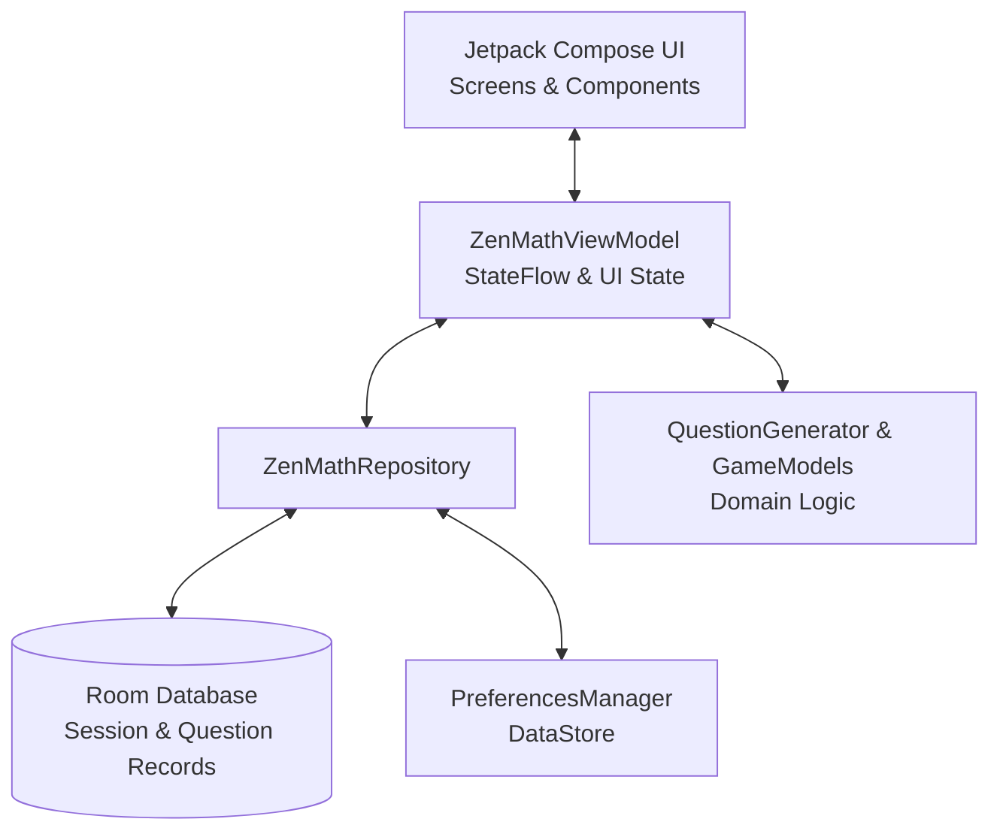

# ZenMath Android — Native Mental Arithmetic & Speed Math Trainer

[](https://www.android.com/)
[](https://kotlinlang.org/)
[](https://developer.android.com/jetpack/compose)
[](https://developer.android.com/training/data-storage/room)

**ZenMath Android** is the native Android implementation of the ZenMath speed arithmetic trainer. Designed for focused, distraction-free mental arithmetic practice, it features a fluid Jetpack Compose UI, offline-first Room persistence, custom on-screen keypad inputs, session analytics, and smart spaced-repetition revision.

---

## 📱 Features

- **Fluid Compose UI**: Minimalist Material 3 theme supporting dynamic color themes, custom typography, and responsive animations.
- **Mental Math Modes**:
  - **Standard Arithmetic**: Addition, subtraction, multiplication, and division across configurable difficulty levels.
  - **Special Operations**: Powers, roots, fractions pool (`FractionsPool.kt`), and percentage estimations.
  - **Timed Sprint & Survival**: High-intensity challenge modes to hone calculation speed.
- **Offline-First Analytics**:
  - Detailed historical breakdown of accuracy, average response latency per operator, and streak tracking using **Room DB** (`ZenMathDatabase.kt`).
  - Question-level replay and mistake review with **Revision Mode**.
- **Custom Fast Keypad**: Low-latency on-screen numeric keypad optimized for one-thumb speed entries.
- **Daily Reminders**: Local notification scheduling (`NotificationScheduler.kt`) with `ReminderReceiver` to sustain daily practice habits.

---

## 🏗️ Architecture

ZenMath follows modern Android Architecture Components (MVVM + Clean Architecture):



### Module & Package Breakdown
```
app/src/main/java/com/example/
├── data/                     # Room Entities, DAOs, Database & Preferences
│   ├── ZenMathDatabase.kt    # App Room database definition
│   ├── ZenMathDao.kt         # Queries for sessions & question records
│   ├── SessionEntity.kt      # Game session persistence model
│   ├── QuestionRecordEntity.kt # Individual problem performance data
│   └── PreferencesManager.kt # DataStore settings management
├── domain/                   # Business & Arithmetic Calculation Logic
│   ├── QuestionGenerator.kt  # Algorithmic problem generation
│   ├── GameModels.kt         # State models, operators & game configurations
│   └── FractionsPool.kt      # Fractions challenge problem pool
├── notifications/            # Local Notification Management
│   ├── NotificationScheduler.kt
│   └── ReminderReceiver.kt
├── ui/                       # Presentation Layer
│   ├── screens/              # MainMenu, GameScreen, StatsScreen, HistoryScreen, RevisionScreen
│   ├── components/           # Custom Keypad, ZenNavbar, StatsComponents
│   ├── theme/                # Theme, Typography, Color palette
│   ├── ZenMathApp.kt         # Navigation root
│   └── ZenMathViewModel.kt   # Central state manager
└── MainActivity.kt           # Single Activity entry point
```

---

## 🛠️ Build and Setup

### Prerequisites
- Android Studio Ladybug / Meerkat or newer
- JDK 17 or higher
- Android SDK 36 (Minimum SDK: 24 / Android 7.0)

### 1. Clone the Repository
```bash
git clone https://github.com/ShihabulSakib/ZenMath_Android.git
cd ZenMath_Android
```

### 2. Build Debug APK
```bash
./gradlew assembleDebug
```
The output APK will be generated at:
`app/build/outputs/apk/debug/app-debug.apk`

### 3. Run Unit and Instrumentation Tests
```bash
./gradlew test
./gradlew connectedAndroidTest
```

---

## 📄 License
This project is open-source under standard development terms.
